# HW4 Annotated Claude Code Session Log

**Feature:** Conflict detection (PRD user story 3: "As an organizer, I am warned when a volunteer is double-booked")
**Branch:** `feature/conflict-detection`
**Tool:** Claude Code v2.1.330, Opus 5.5, Windows
**Date:** 2026-11-22, about 7:05 PM to 8:40 PM ET

This log follows one real feature from start to finish: Explore, then Plan, then Implement with strict TDD, then Commit. It also shows the context-management strategy from `docs/hw4/context-management.md` used in a real session: `/context`, `/clear`, `/compact` with a focus hint, `--continue`, `--resume` and `/export`.

Every screenshot is in `docs/hw4/session-logs/`. The raw transcript is `docs/hw4/session-logs/conflict-detection-session.txt`. `/export` saves the conversation as it stands after the last `/compact`, so the transcript starts at the green commit of Cycle 2. Screenshots cover everything before that.

> Lines that start with **Annotation** are our comments. Everything else is quoted from the session.

---

## 0. Setup: CLAUDE.md loads the strategy through @import

`CLAUDE.md` imports two files: `@docs/PRD.md` and `@docs/hw4/context-management.md`.

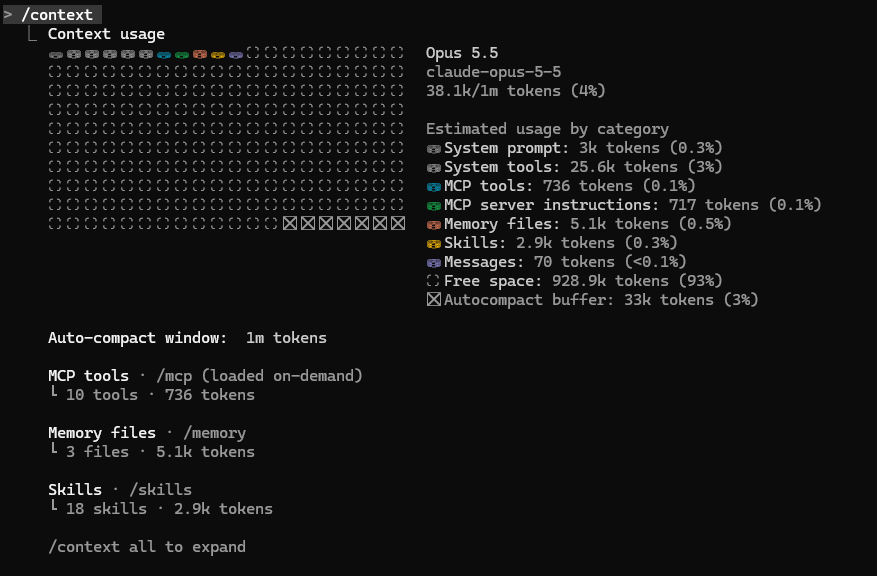

**Annotation:** On a fresh session, `/context` lists **3 memory files (5.1k tokens)**: CLAUDE.md and the two imported files. Messages use only 70 tokens.

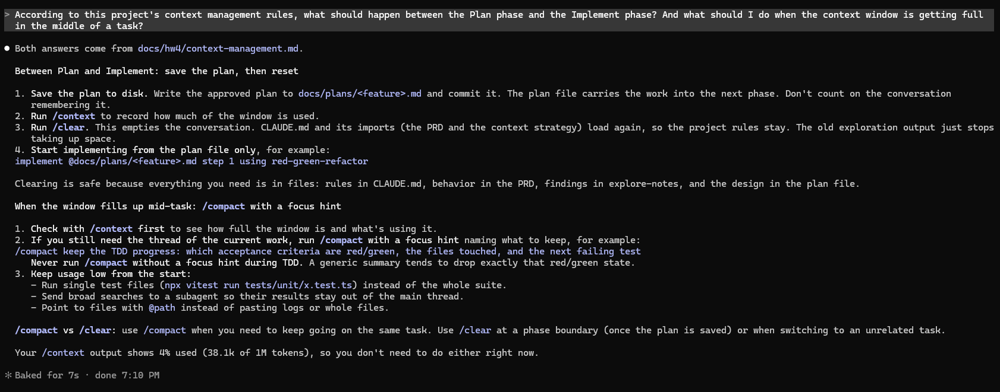

**Annotation:** We asked, "According to this project's context management rules, what should happen between the Plan phase and the Implement phase?" Claude answered from the imported file ("Both answers come from docs/hw4/context-management.md"): save the plan, run `/context`, `/clear`, then implement from the plan file. Mid-task, use `/compact` with a focus hint. This shows the @import is loaded and that Claude follows it.

---

## 1. Explore: subagent search, read-only

```
/rename hw4-conflict-detection
> Use a subagent to explore the codebase for conflict detection (PRD user story 3). Find the Shift type,
  how start/end times are stored, where assignedVolunteerIds is used, and the existing domain/test
  patterns. Do not write any code. Then write the findings to docs/explore/conflict-detection.md.
```

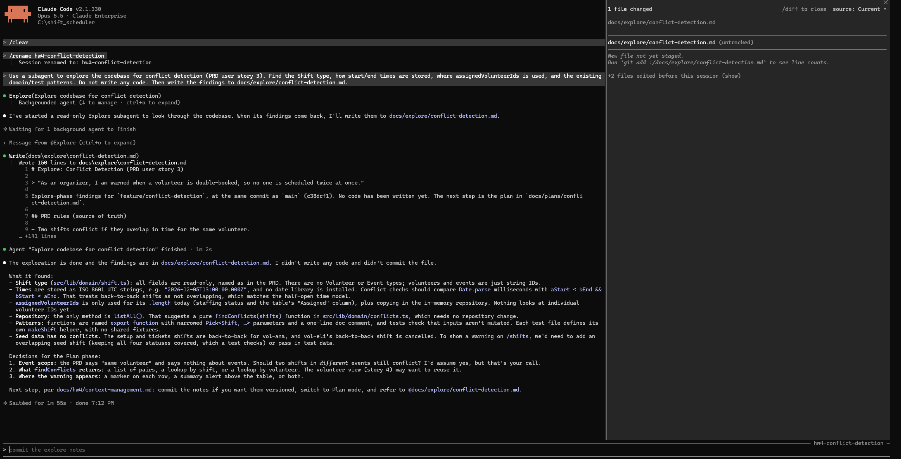

**Annotation:** Claude started a background **Explore subagent** (about 1 minute). The main session received only the subagent's summary and then wrote 150 lines of notes. The subagent found:
- times are ISO UTC strings, and there is no date library
- the half-open overlap check `aStart < bEnd && bStart < aEnd`
- the seed data has no conflicts

It also raised three decisions for the Plan phase: event scope, return shape, and UI scope.

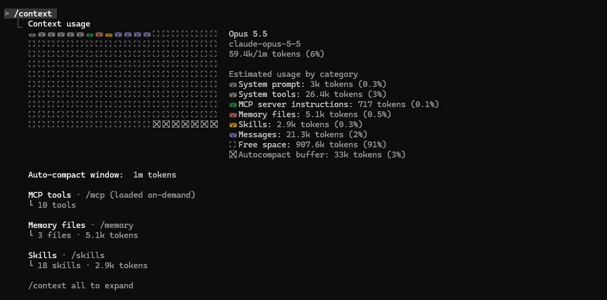

**Annotation:** After exploring, Messages used **21.3k tokens**. The subagent read many files, but only its summary reached the main context.

Commit: `1957a4a docs(explore): add conflict detection explore notes`

---

## 2. Plan: Plan mode, decisions, saved plan

We switched to Plan mode (`Shift+Tab`) and asked for a plan based on `@docs/explore/conflict-detection.md`.

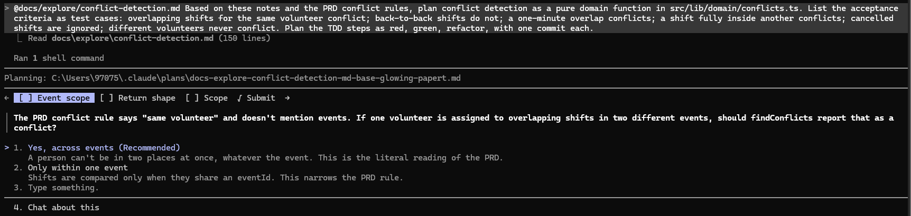

**Annotation:** In Plan mode (`Planning: …` in the header), Claude asked the three open questions as multiple choice. We chose:
1. Shifts in different events still conflict.
2. The function returns a flat list of `{ volunteerId, shiftIds }` pairs.
3. Scope is the domain function only. The UI warning is a separate session.

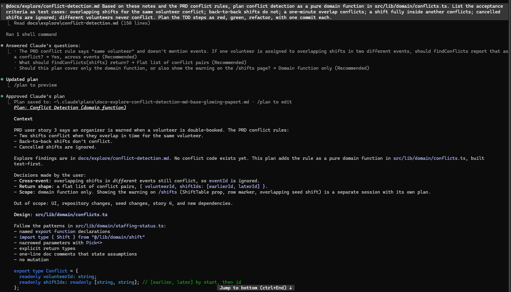
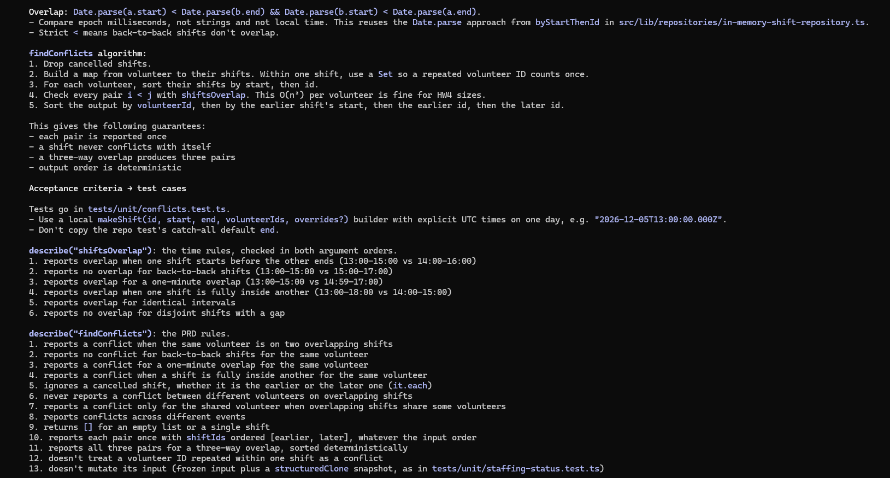

**Annotation:** The approved plan has:
- the design: pure functions `shiftsOverlap` and `findConflicts` in `src/lib/domain/conflicts.ts`, comparing epoch milliseconds with strict `<`
- 19 acceptance criteria written as test names
- TDD steps with **one commit per red, green and refactor**

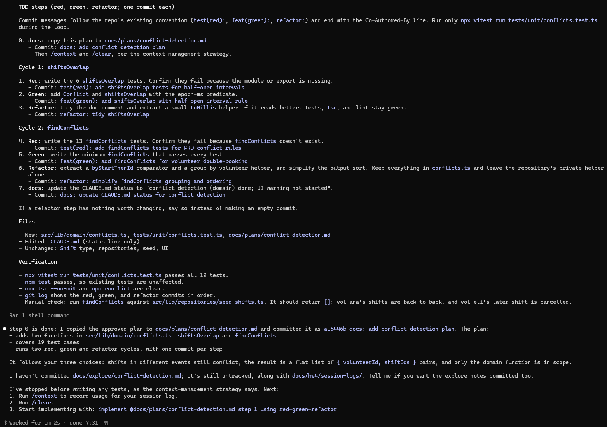

**Annotation:** Claude copied the plan into the repo and committed it. Then it **stopped on its own** and reminded us to run `/context` and `/clear` before implementing. It was following the rule in the imported strategy file.

Commit: `a15446b docs: add conflict detection plan`

---

## 3. Reset: `/clear` between Plan and Implement

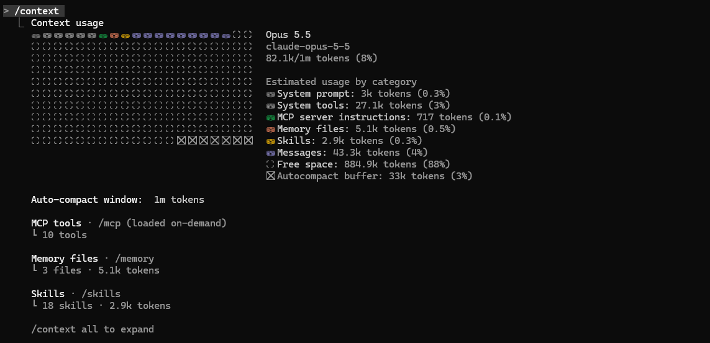
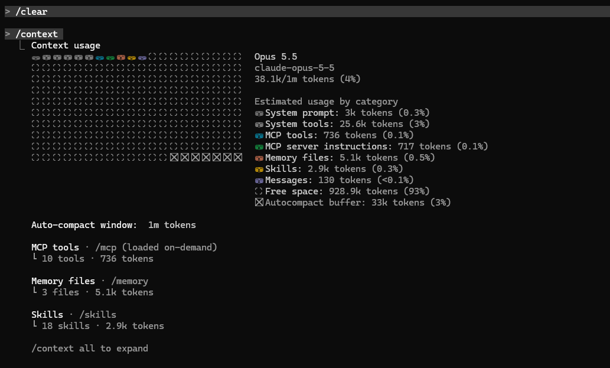

**Annotation:** This is the key context-management result.

| | Before `/clear` | After `/clear` |
|---|---|---|
| Total | 82.1k tokens (8%) | 38.1k tokens (4%) |
| Messages | **43.3k** | **130** |
| Memory files | 5.1k | 5.1k |

The conversation history was dropped, and the project rules (CLAUDE.md, PRD, strategy) stayed. Nothing was lost, because the explore notes and the plan were already committed as files.

---

## 4. Implement: strict TDD, two cycles

We implemented from the plan file only:

```
> Implement @docs/plans/conflict-detection.md ... using strict TDD ... show me each red failure
  before writing code, and commit each red, green, and refactor step. Stop after each commit.
```

### Cycle 1: `shiftsOverlap`

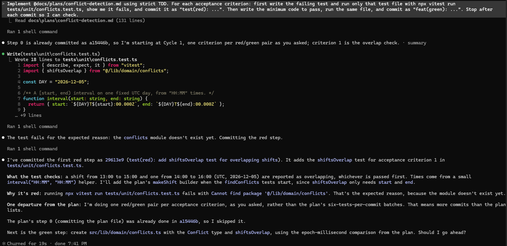

**Annotation (RED):** First Claude wrote a test only. It failed with `Cannot find package '@/lib/domain/conflicts'`, the expected reason. Committed as `29613e9 test(red)`.

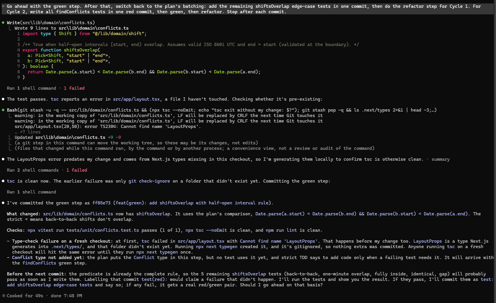

**Annotation (GREEN):** The minimum code was one line: `Date.parse(a.start) < Date.parse(b.end) && Date.parse(b.start) < Date.parse(a.end)`. Committed as `ff05e73 feat(green)`. Claude also hit the `LayoutProps` tsc error on a fresh checkout, worked out that it predates the change, and fixed it locally with `npx next typegen`.

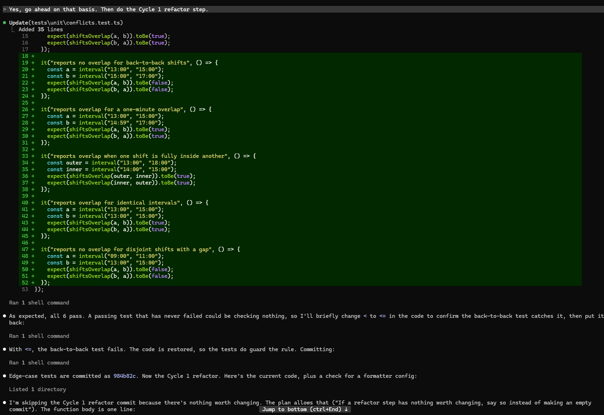

**Annotation (honest history):** The five edge-case tests (back-to-back, one-minute overlap, fully inside, identical, gap) **passed immediately**, so Claude committed them as `test:` instead of pretending they were `test(red):`. To prove they were not empty tests, it **temporarily changed `<` to `<=`**: the back-to-back test failed. Then it restored the code. Committed as `984b82c test`.

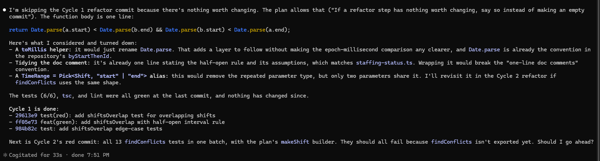

**Annotation (REFACTOR):** Claude skipped the Cycle 1 refactor because the body is one line. It listed the options it considered and turned down: a `toMillis` helper, rewording the doc comment, and a `TimeRange` alias. The plan allowed this ("say so instead of making an empty commit").

### Cycle 2: `findConflicts`

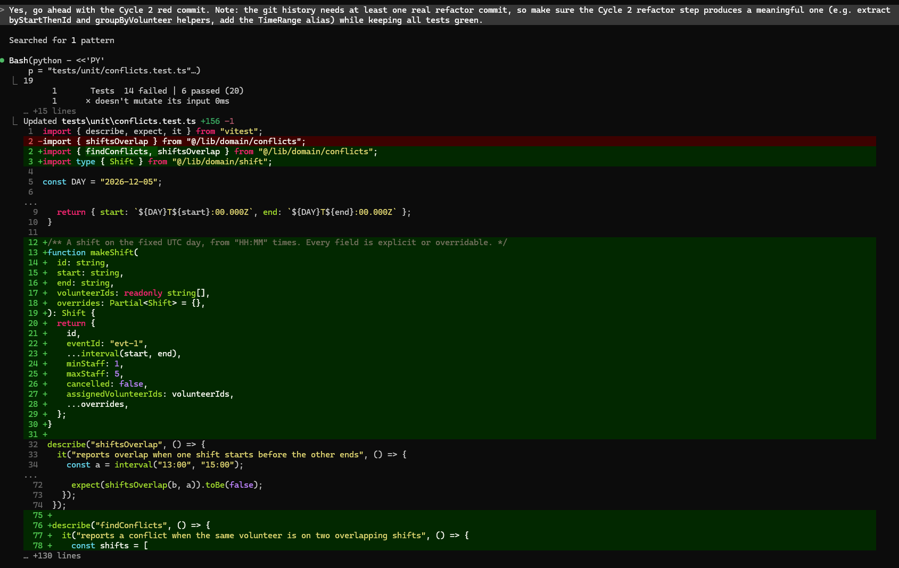
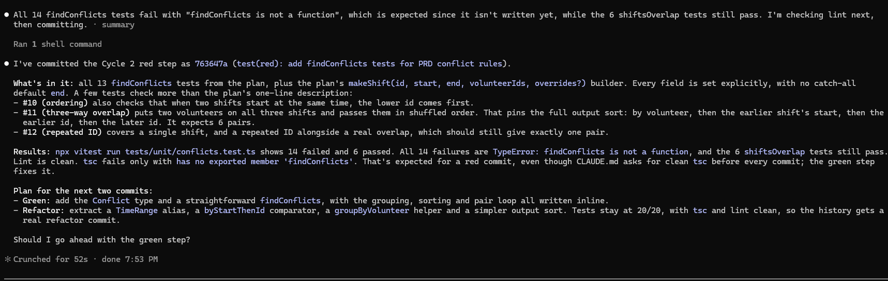

**Annotation (RED):** Claude wrote all 13 `findConflicts` criteria (14 test cases) in one batch: **14 failed, 6 passed**. Every failure was `TypeError: findConflicts is not a function`. Committed as `763647a test(red)`.

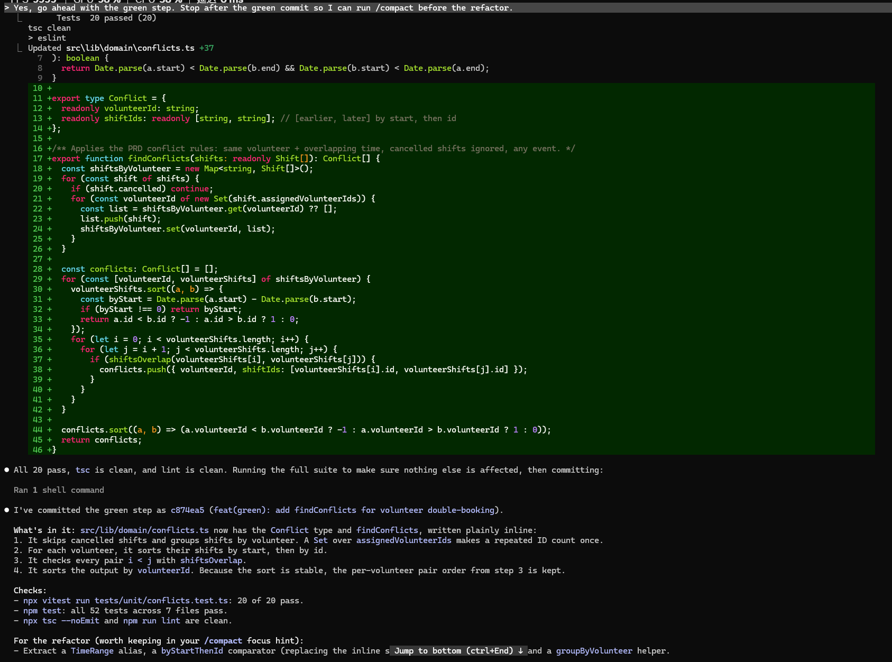

**Annotation (GREEN):** A straightforward inline implementation:
1. skip cancelled shifts
2. group shifts by volunteer, using a `Set` so a repeated ID counts once
3. sort each volunteer's shifts by start, then id
4. check pairs `i < j`

Results: 20/20 conflict tests passed, the full suite of 52 tests passed, and tsc and lint were clean. Committed as `c874ea5 feat(green)`.

---

## 5. `/compact` with a focus hint, mid-task

Before the refactor, we compacted instead of clearing, because we were still in the middle of the task.

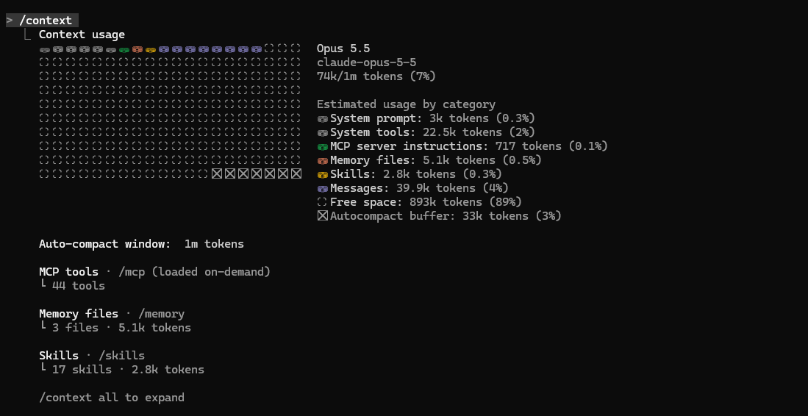

```
/compact keep the TDD progress: which acceptance criteria are red/green, the commits so far,
the files touched, and that the next step is the Cycle 2 refactor (TimeRange alias,
byStartThenId comparator, groupByVolunteer helper)
```

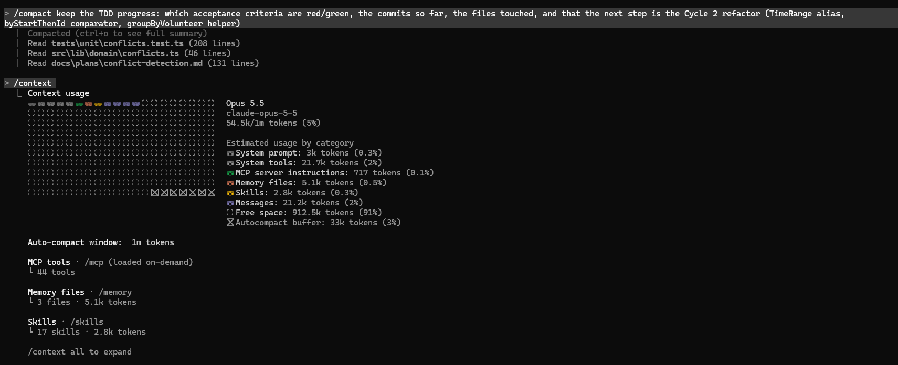

**Annotation:** Messages went from **39.9k to 21.2k**. After compacting, Claude automatically re-read the three working files: the test file, `conflicts.ts`, and the plan.

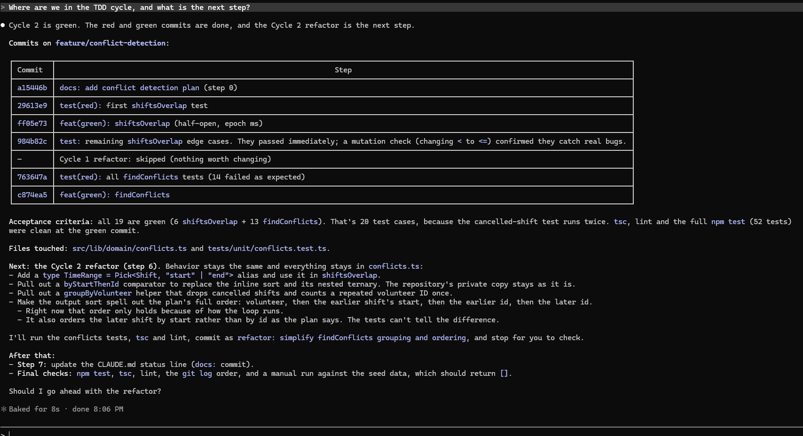

**Annotation:** We asked "Where are we in the TDD cycle, and what is the next step?" Claude gave a table of every commit, the status of all 19 criteria, the files touched, and the exact refactor steps. **The focus hint kept the red/green state**, which a plain summary tends to lose.

---

## 6. Refactor and finish

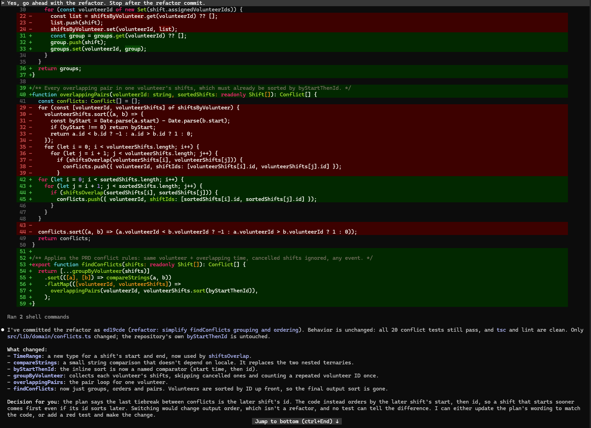

**Annotation (REFACTOR):** Claude extracted these helpers:
- `TimeRange`
- `compareStrings` (locale-independent)
- `byStartThenId`
- `groupByVolunteer`
- `overlappingPairs`

`findConflicts` became a three-step pipeline: group, order, pair. Behavior did not change and all 20 tests stayed green. Committed as `ed19cde refactor`.

Claude also noticed the plan described the tie-break order slightly differently from the code, and **asked instead of silently changing behavior**.

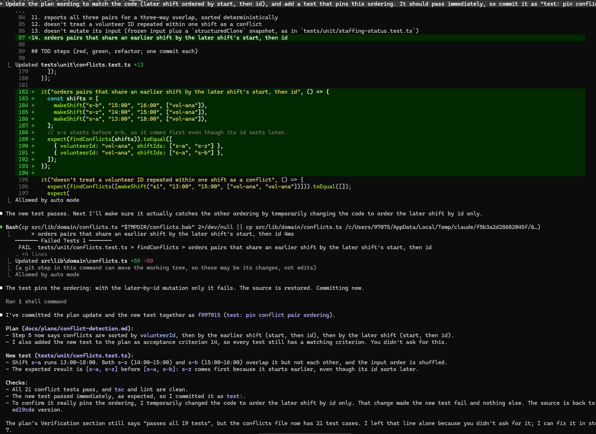

**Annotation:** We chose to match the plan to the code and pin the order with a test. The new test passed immediately. A temporary mutation (ordering by id only) made it fail, which proves it guards the order. Committed as `f997915 test: pin conflict pair ordering`.

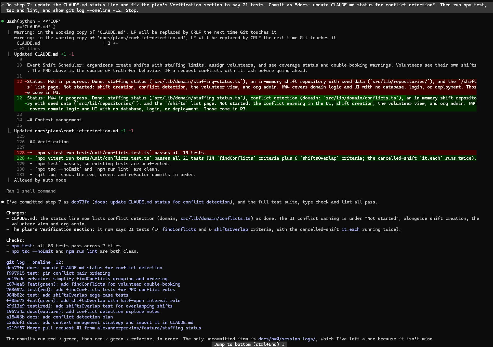

**Annotation (COMMIT):** Final history on the branch:

```
dcb73fd docs: update CLAUDE.md status for conflict detection
f997915 test: pin conflict pair ordering
ed19cde refactor: simplify findConflicts grouping and ordering
c874ea5 feat(green): add findConflicts for volunteer double-booking
763647a test(red): add findConflicts tests for PRD conflict rules
984b82c test: add shiftsOverlap edge-case tests
ff05e73 feat(green): add shiftsOverlap with half-open interval rule
29613e9 test(red): add shiftsOverlap test for overlapping shifts
1957a4a docs(explore): add conflict detection explore notes
a15446b docs: add conflict detection plan
c38dcf1 docs: add context management strategy and import it in CLAUDE.md
```

The full suite passes: 53 tests across 7 files, plus `tsc --noEmit` and `lint`. CLAUDE.md was updated in the same branch (status line), so CLAUDE.md keeps evolving with the code.

---

## 7. `--continue`, seed check, `/export`, `--resume`

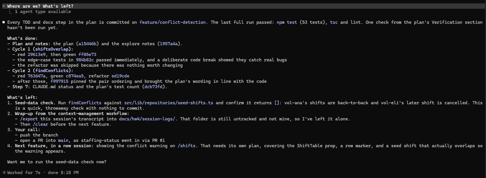

**Annotation:** We quit Claude Code (`Ctrl+C` twice) and ran `claude --continue`. Asked "Where are we? What's left?", Claude listed every commit and the remaining steps with no re-explaining from us.

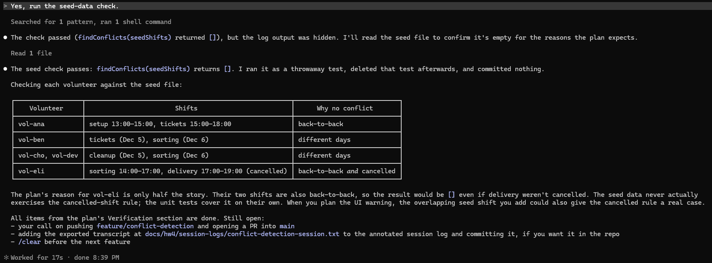

**Annotation:** The plan's last verification step: `findConflicts(seedShifts)` returns `[]`. Claude ran it as a throwaway test and committed nothing. It also pointed out that the seed data never actually exercises the cancelled-shift rule (vol-eli's shifts are back-to-back anyway). That is a useful note for the UI-warning feature.

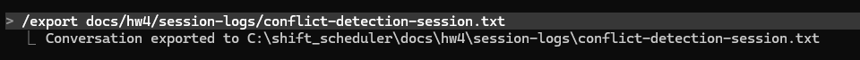
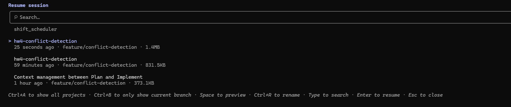

**Annotation:** `/export` saved the transcript. `claude --resume` lists past sessions by the name we gave with `/rename` (`hw4-conflict-detection`), along with the branch and size, so an older session (for example the planning one) is easy to reopen.

---

## Summary of evidence

| HW4 requirement | Where |
|---|---|
| CLAUDE.md with @import | `CLAUDE.md` (`@docs/PRD.md`, `@docs/hw4/context-management.md`). Screenshots 01–02. |
| Context management (`/clear`, `/compact`, `--continue`) | Sections 3, 5 and 7. Screenshots 06–10 and 12. |
| Explore → Plan → Implement → Commit | Sections 1–6. Commits `1957a4a` → `a15446b` → … → `dcb73fd`. |
| TDD red → green → refactor | Commits `29613e9`/`ff05e73` and `763647a`/`c874ea5`/`ed19cde`. Screenshots tdd-01 to tdd-10. |
| Tests before implementation | Every `test(red)` commit fails on the parent code (see `docs/hw4/test-results.md` for the replay of the earlier feature). |
